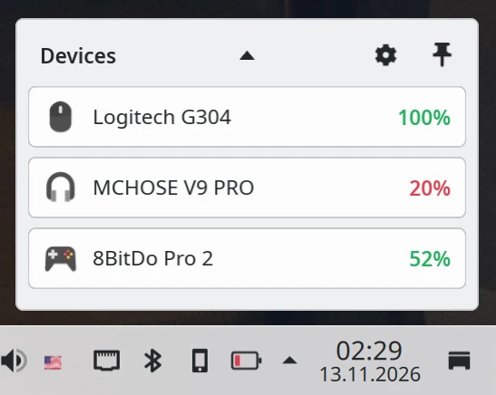

<div align="center">
  
  <h1>shinpi</h1>

  <a href="LICENSE"></a>
</div>

---

> [!NOTE]
> **Active Development:** `shinpi` changes frequently and may contain bugs. Saved settings may become outdated after updates; `Reset` at the bottom of General restores appearance defaults. Support for individual HID devices still requires verification on physical hardware.

---

`shinpi` is a Linux tray application for checking device battery levels in one place. Built with Rust, Slint and FemtoVG, it provides native windows styled for KDE Plasma without a browser engine.

<p align="center">
  
</p>

---

## Features

- Battery readings through Linux `power_supply`, BlueZ, UPower and selected HID receivers.
- Manual device selection, custom names and icons, and saved readings for disconnected devices.
- A tray battery icon showing the lowest device level, with color, monochrome and orientation options.
- Low-battery notifications with a configurable threshold and shared repeat interval.
- Optional notification history and adjustable popup width.
- English and Russian interfaces, automatic language selection, and system, light and dark themes.

---

## Controls & Shortcuts

<details>
<summary>Show controls and shortcuts</summary>

| Input | Action |
| --- | --- |
| Left-click on tray | Toggle the device panel and refresh readings when opening. |
| Right-click on tray | Open the Refresh, Settings and Quit menu. |
| Gear icon | Open settings. |
| `Add` | Choose a discovered device to display. |
| Pencil in Settings | Change a device's name and icon. |
| Red `×` in Settings | Remove a device from the panel. |
| Diagnostics in Settings → Devices | Open source and access diagnostics. |
| Open About | Check the latest stable version automatically when enabled; otherwise use `Check for updates` beside the version. Open the release page when an update is available. |
| Five quick clicks on the About logo | Show or hide Dev. Window dimensions, logo size, resize lock and Dev visibility are saved automatically. |
| Lock window resizing in Dev | Prevent manual window resizing (enabled by default). Unlocked settings window dimensions are saved when resized. |
| Icon sources in Dev | Expand or collapse icon format diagnostics. |
| Automatically check for updates in Dev | Enable or disable checks when opening About (enabled by default); the preference is saved. |
| Reset in Dev | Restore the default window dimensions, logo size, resize lock and automatic update checks. |
| Reset at the bottom of General | Restore appearance defaults and hide Dev; keep selected devices, notification history, notification rules and the update-check preference. |
| Panel width and Recent notifications in General → Appearance | Set the device panel width and displayed history count; `0` disables the notification panel. |
| Triangle | Toggle notification history. |
| `×` on a notification | Dismiss the entry. |
| Pin icon | Keep the panel open when it loses focus. |
| `Escape` | Close the unpinned panel. |
| `Tab`, `Enter`, `Space` | Navigate and activate toolbar controls. |
| `--window` | Open the panel at startup. |
| `--once` | Print readings and source warnings as JSON. |
| `--print-udev-rules` | Print access rules for supported HID devices. |
| `--help` | Show command-line help. |

The empty panel's `Add` button disappears after selecting a device; further devices are added through Settings. Sources are listed separately, so choose the source that works best for each device.

Discrete battery levels are displayed as estimates: Critical `10%`, Low `25%`, Normal `50%`, High `75%`, Full `100%`. These estimates use the same color scale and notification threshold as numeric readings.

</details>

---

## Installation & Usage

### Architecture & Format Support

| Format | `x86_64` | `arm64` |
| --- | :---: | :---: |
| `AppImage` | ✅ | ❌ |
| `Flatpak` | ✅ | ❌ |

Stable releases use `X.Y.0`. Versions with a non-zero final component, such as `X.Y.1`, are automatic dependency-update prereleases.

Download the [latest stable release](https://github.com/yrmuq/shinpi/releases/latest), or browse [all releases](https://github.com/yrmuq/shinpi/releases). Development builds remain in the `dev` draft and are not the stable update source.

### AppImage

Requires `x86_64` Linux with `glibc` 2.39 or newer, working graphics drivers, a system D-Bus and a StatusNotifier-compatible tray. KDE Plasma is the primary desktop environment.

Download `shinpi-x86_64.AppImage` from the [latest stable release](https://github.com/yrmuq/shinpi/releases/latest). Use [Gear Lever](https://flathub.org/apps/it.mijorus.gearlever) to install and integrate it with the desktop. The AppImage embeds a stable GitHub Releases update source. Its matching `.zsync` supports efficient updates through Gear Lever; import the AppImage itself, not the `.zsync`.

### Flatpak

Install the `x86_64` stable branch with `shinpi.flatpakref` from the stable release. It uses the signed repository at [yrmuq.github.io/shinpi](https://yrmuq.github.io/shinpi/). `arm64` packages are not built. A development test bundle does not replace this repository.

Packages are distributed through GitHub Releases; `shinpi` is not listed on Flathub. Open `shinpi.flatpakref` in your software manager to install it. Subsequent updates use `flatpak update` or a compatible desktop software manager. [Warehouse](https://flathub.org/apps/io.github.flattool.Warehouse) can manage installed Flatpak applications. The standalone `.flatpak` bundle is an additional installation option; prefer `.flatpakref` to configure the signed update remote.

### HID Access

System battery sources work through the available kernel interfaces, BlueZ or UPower. Some supported HID receivers also need local device-access rules. If Diagnostics reports a permission error, export and install the rules, then reconnect the device:

```sh
./shinpi-x86_64.AppImage --print-udev-rules > 70-shinpi.rules
sudo install -m 0644 70-shinpi.rules /etc/udev/rules.d/70-shinpi.rules
sudo udevadm control --reload-rules
```

The application runs as a regular user. The rules use `uaccess` for the active local session.

---

## License & Attribution

`shinpi` is licensed under [GPL-3.0-or-later](LICENSE). See [NOTICE](NOTICE), the [Breeze icon license](ui/icons/COPYING) and [bundled component notices](packaging/appimage/BUNDLED.txt) for attribution details.

| Component | Upstream | License | Integration Details |
| --- | --- | --- | --- |
| Breeze icons | [KDE/breeze-icons](https://github.com/KDE/breeze-icons) | `LGPL-3.0-or-later` | Bundled gear and pin icons. |
| `slint` | [slint-ui/slint](https://github.com/slint-ui/slint) | `GPL-3.0-only` or [alternative terms](https://github.com/slint-ui/slint/blob/master/LICENSE.md) | Native interface with FemtoVG rendering. |
| `ksni` | [iovxw/ksni](https://github.com/iovxw/ksni) | `Unlicense` | StatusNotifier tray integration. |
| `zbus` | [z-galaxy/zbus](https://github.com/z-galaxy/zbus) | `MIT` | Desktop and device D-Bus interfaces. |
| `hidapi` | [ruabmbua/hidapi-rs](https://github.com/ruabmbua/hidapi-rs) | `BSD-3-Clause` | HID device access. |
| `resvg` | [linebender/resvg](https://github.com/linebender/resvg) | `Apache-2.0 OR MIT` | Tray icon rasterization. |
